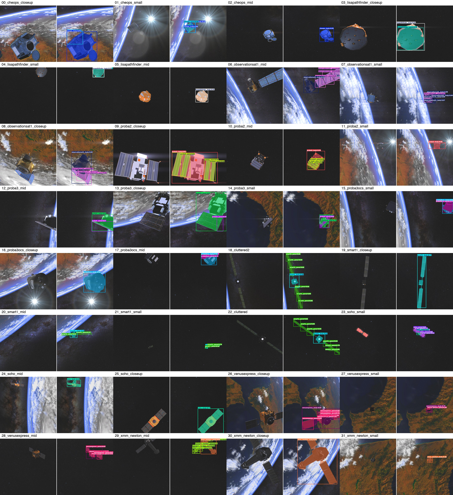

# SPARK — Spacecraft Perception

A single compact model for classification, detection and fine-grained component
segmentation of spacecraft — built for the SPARK 2026 perception track.



## Data

| Edition | Images | Classes | Labels |
| :--- | :--- | :--- | :--- |
| SPARK 2022 | 110k (66k / 22k / 22k) | 11 | boxes |
| SPARK 2026 | 80k (60k / 20k) | 10 | component masks (body / panel) |

## Results

| Metric | Value |
| :--- | :--- |
| Classification (S_cls) | 0.9995 |
| Detection (AP50-95 / AP50) | 0.929 / 0.997 |
| Segmentation (S_seg) | 0.831 (body 0.910 / panel 0.752) |
| Overall accuracy (S_acc) | **0.9039** |
| Parameters | 3.09 M |
| GFLOPs | 10.5 |

`S_acc = 0.20·S_cls + 0.40·S_det + 0.40·S_seg` · *metrics measured on a held-out 2k-image validation subset*

## Approach

Progressed from the 2022 detection edition (Model A) into the 2026 multi-task task, where
the problem is **recast as a single 20-class instance segmentation task**: each satellite
splits into its components — `10 satellites × {body, panel}`.

- **classification** is read off the predicted component classes (no separate classifier)
- **detection** boxes are the per-satellite union of component boxes
- **segmentation** is the body / panel masks directly

One YOLO26n-seg, 46 epochs on 80k images (60k train / 20k val) at 640px.

## Findings

- **2022 pretraining adds nothing** when fine-tuning on 60k images (A/B experiment)
- **Label quality was the biggest lever**: fragmented → clean component labels lifted
  instance mask mAP50-95 from 0.31 to 0.60
- **Fractional box padding (δ = 0.02)** raised mean box IoU from 0.884 to 0.937

## Quickstart

```bash
pip install -r requirements.txt

# needs the project data/ and the released weights under runs/
# SPARK_ROOT = the directory containing them
SPARK_ROOT=/path/to/project python code/eval/inference_preview.py
```

## Layout

```
code/data/    dataset conversion (CSV / masks -> YOLO polygons)
code/train/   local training entry points
code/eval/    evaluation, scoring, visual inspection
kernels/      Kaggle training jobs as run
results/      per-run results.csv + args.yaml
figures/      inference previews
```

## Links

- **Datasets** — [spark2026-comp20-labels](https://www.kaggle.com/datasets/huseyincavus/spark2026-comp20-labels) ·
  [spark2026-seg](https://www.kaggle.com/datasets/huseyincavus/spark2026-seg) ·
  [spark2026-comp-labels](https://www.kaggle.com/datasets/huseyincavus/spark2026-comp-labels)
- **Weights** — [spark-2026-comp20-seg](https://huggingface.co/huseyincavus/spark-2026-comp20-seg) ·
  [spark-spacecraft-weights](https://huggingface.co/huseyincavus/spark-spacecraft-weights)

---

*Work in progress · raw data not stored in this repository*

*Datasets: SPARK 2022 / SPARK 2026 (CVI2, University of Luxembourg)*
